# Git y Github

<!--
Correcciones:
- Uniformizar el tamaño de las imágenes
- Traducir la imagen que tiene inglés al español
- Mejorar la redacción (escribir en tercera persona)
- Investigar cómo poner salidas de terminal con css y html en vez de las imágenes
-->

<div class="alert alert-warning" role="alert">
  🚧 <strong>Sitio en construcción</strong> — Este contenido está en desarrollo y puede cambiar.
</div>

## Introducción

<h3>Git</h3>

<p>Es un <b>sistema de control de versiones</b> de código abierto que <em>registra los cambios en los archivos</em>. Te permite trabajar en tu propia copia de un proyecto, registrar un historial de tus cambios y fusionar tu trabajo con los cambios de otras personas de forma segura y eficiente.</p>

<h3>GitHub</h3>

<p>Es una <b>plataforma</b> que <em>respalda todo tu proceso</em> de desarrollo de software, desde la planificación del trabajo hasta el despliegue y la operación del software.</p>

<h3>Git y GitHub</h3>

<p><b>GitHub</b> se contruye sobre <b>Git</b> alojando tus proyectos de Git, llamados <b>repositorios</b>, en la nube, además de añadir herramientas de planificación y colaboración que facilitan el trabajo en equipos.</p>

## Instalación de Git

<ul class="nav nav-tabs" role="tablist">
  <li role="presentation" class="active"><a href="#windows_git_install" aria-controls="windows" role="tab" data-toggle="tab">Windows</a></li>
  <li role="presentation"><a href="#linux_git_install" aria-controls="linux" role="tab" data-toggle="tab">Linux</a></li>
</ul>

 <!-- SECCION WINDOWS-->

<div class="tab-content">

  <div role="tabpanel" class="tab-pane active" id="windows_git_install">
    
    <p> </p>

    <p>Desde el menú de inicio, abre el <b>PowerShell</b> con clic derecho y selecciona la opción <b>Ejecutar como administrador</b>. Luego ejecuta el siguiente comando:</p>

    <pre><code>winget install --id Git.Git -e --source winget</code></pre>

    El sistema descargará el ejecutable y te preguntará si quieres abrir la aplicación como adiminstrador. Dale clic en <b>Aceptar</b> y se abrirá la <b>ventana de instalación</b>. Cuando termine de instalar, cierra y abre el <b>PowerShell</b> para que reconozca el comando, y verifica con:

    <pre><code>git --version</code></pre>

    <p>Te aparecerá lo siguiente:</p>

    <div class="powershell-output">

    <pre>git version 2.55.0.windows.5</pre>

    </div> 

    <p>¡Listo! Haz instalado Git en tu computadora.</p>

  </div>


 <!-- SECCION LINUX -->

    <div role="tabpanel" class="tab-pane" id="linux_git_install">
  
    <p> </p>

    <p>Abre una <b>terminal</b> y ejecuta lo siguiente:</p>

    <pre><code>sudo apt update
sudo apt install git</code></pre>

    <h4>Explicación</h4>    

    <p><code>sudo apt uptate</code> <em>actualiza la lista de paquetes disponibles</em> de todo el sistema, pero no instala ni actualiza ningún programa. En nuestro caso particular, sólo lo usamos para obtener la última versión de git en el sistema. La instalación de git como tal se realiza con <code>sudo apt install git</code>, que al ejecutarlo aparecerá lo siguiente:</p>

    <div class="terminal-output" markdown="0">

    <pre>Leyendo lista de paquetes... Hecho
Creando árbol de dependencias... Hecho
Leyendo la información de estado... Hecho
Se instalarán los siguientes paquetes adicionales:
  git-man
Paquetes sugeridos:
  git-daemon-run | git-daemon-sysvinit git-doc git-email git-gui gitk gitweb
  git-cvs git-mediawiki git-svn
Se instalarán los siguientes paquetes NUEVOS:
  git
Se actualizarán los siguientes paquetes:
  git-man
1 actualizados, 1 nuevos se instalarán, 0 para eliminar y 159 no actualizados.
Se necesita descargar 4 781 kB de archivos.
Se utilizarán 22.2 MB de espacio de disco adicional después de esta operación.
¿Desea continuar? [S/n]</pre>
    
    </div>

    <p>El sistema te preguntará si deseas continuar con la instalación de los paquetes enlistados. Escribe <b>s</b> y presiona <b>Enter</b> para confirmar.</p>

    <div class="terminal-output" markdown="0">

    <pre>Des:1 http://archive.ubuntu.com/ubuntu noble-updates/main amd64 git-man all 1:2.43.0-1ubuntu7.4 [1 101 kB]
Des:2 http://archive.ubuntu.com/ubuntu noble-updates/main amd64 git amd64 1:2.43.0-1ubuntu7.4 [3 681 kB]
Descargados 4 781 kB en 6s (756 kB/s)                                               
(Leyendo la base de datos ... 308160 ficheros o directorios instalados actualmente.)
Preparando para desempaquetar .../git-man_1%3a2.43.0-1ubuntu7.4_all.deb ...
Desempaquetando git-man (1:2.43.0-1ubuntu7.4) sobre (1:2.43.0-1ubuntu7.3) ...
Seleccionando el paquete git previamente no seleccionado.
Preparando para desempaquetar .../git_1%3a2.43.0-1ubuntu7.4_amd64.deb ...
Desempaquetando git (1:2.43.0-1ubuntu7.4) ...
Configurando git-man (1:2.43.0-1ubuntu7.4) ...
Configurando git (1:2.43.0-1ubuntu7.4) ...
Procesando disparadores para man-db (2.12.0-4build2) ...
</pre>

    </div>

    <p>Verifica si la instalación se realizó exitosamente:</p>

    <pre><code>git --version</code></pre>

    <p>Te aparecerá lo siguiente:</p>

    <div class="terminal-output" markdown="0">
     <pre>git version 2.43.0</pre>
    </div>
  
    <p>¡Listo! Haz instalado Git en tu computadora.</p>

  </div>

</div>

## Configuración de Git

<p>El siguiente paso importante es configurar Git con los datos necesarios para usarlo.</p>

<h4>Nombre de usuario</h4>

Se asigna con el siguiente comando, cambiando <code>tu nombre</code> por el nombre que prefieras para tu usuario:

<pre><code>git config --global user.name tu_nombre
</code></pre>

<h4>Correo electrónico</h4>

Cambia <code>tu@correo.com</code> por el correo de tu preferencia:

<pre><code>git config --global user.email tu@correo.com
</code></pre>

<h4>Editor de texto</h4>

Cambia <code>tu_editor</code> por el nombre del editor de texto que sueles usar:

<pre><code>git config --global core.editor tu_editor
</code></pre>

<h4>Rama principal</h4>

Vamos a utilizar la rama <code>main</code>:

<pre><code>git config --global init.defaultBranch main
</code></pre>

Para ver las **configuraciones** de git en el dispositivo (nombre, correo, editor de texto):

<pre><code>git config -l</code></pre>

## Creación de repositorio en Github

<p>Primero, crea una cuenta de Github mediante en siguiente enlace: <a href="https://github.com/signup?ref_cta=Sign+up&ref_loc=header+logged+out&ref_page=%2F&source=header-home" target="_blank" rel="noopener noreferrer">crear cuenta de Github</a>. Posteriormente, sigue las indicaciones como se muestran a continuación:</p>

 <div class="auto-carousel" data-images='[
    {"src": "../../images/creacion_repositorio_1.png", "title": "Paso 1", "desc": "Ve a la sección \"Create New\"."},
    {"src": "../../images/creacion_repositorio_2.png", "title": "Paso 2", "desc": "Dale clic en <br>\"New repository\"."},
    {"src": "../../images/creacion_repositorio_3.png", "title": "Paso 3", "desc": "Define el nombre de tu repositorio."},
    {"src": "../../images/creacion_repositorio_4.png", "title": "Paso 4", "desc": "Añade una descripción."},
    {"src": "../../images/creacion_repositorio_5.png", "title": "Paso 5", "desc": "Escoge la visibilidad."},
    {"src": "../../images/creacion_repositorio_6.png", "title": "Paso 6", "desc": "Añade un \"READ ME\"."},
    {"src": "../../images/creacion_repositorio_7.png", "title": "Paso 7", "desc": "Deja \"No.gitignore\" por defecto."},
    {"src": "../../images/creacion_repositorio_8.png", "title": "Paso 8", "desc": "Selecciona la licencia \"GNU General Public License v3.0\"."},
    {"src": "../../images/creacion_repositorio_9.png", "title": "Paso 9", "desc": "Dale clic en \"Create repository\"."},
    {"src": "../../images/creacion_repositorio_10.png", "title": "Paso final", "desc": "¡Listo! Haz creado tu repositorio en GitHub."}
    ]'>
</div>

<p>¿Llegaste al paso final? ¡Felicidades! Haz creado tu primer repositorio en GitHub.</p>

## Instalación de Github CLI 

<p><b>GitHub CLI</b> te permite usar Github directamente desde la línea de comandos de la terminal o el PowerShell. En particular, conecta la computadora con tu repositorio de Github en la nube.</p>

<!-- CODIGO PARA SECCIONES WINDOWS Y LINUX -->

<ul class="nav nav-tabs" role="tablist">
  <li role="presentation" class="active"><a href="#windows_githubcli" aria-controls="windows" role="tab" data-toggle="tab">Windows</a></li>
  <li role="presentation"><a href="#linux_githubcli" aria-controls="linux" role="tab" data-toggle="tab">Linux</a></li>
</ul>


 <!-- SECCION WINDOWS-->

<div class="tab-content">

  <div role="tabpanel" class="tab-pane active" id="windows_githubcli">
    
    <p> </p>
    <p>Abre el <b>PowerShell</b> y ejectua el siguiente comando:</p>
    
    <pre><code>winget install --id GitHub.cli --source winget</code></pre>

    El sistema realizará el proceso de instalación. En algún punto te preguntará si quieres permitir que la aplicación realice cambios en tu dispositivo. Le das clic a <b>Sí</b>. Al final debe aparecer "Instalado correctamente".

    <div class="powershell-output">

    <pre>
Encontrado GitHub CLI [GitHub.cli] Versión 2.102.0 

El propietario de esta aplicación le concede una licencia. 

Microsoft no es responsable, ni tampoco concede ninguna licencia de paquetes de terceros. 

El hash del instalador se verificó correctamente 

Iniciando instalación de paquete... 

Instalado correctamente</pre>
    </div>

    <p>Por último, cierra y abre el powershell para finalizar la instalación.</p>
 
  </div>


 <!-- SECCION LINUX -->

  <div role="tabpanel" class="tab-pane" id="linux_githubcli">
    
    <p> </p>

    <p>Abre una <b>terminal</b> y ejecuta el siguiente conjunto de comandos:</p>
    
    <pre><code>(type -p wget >/dev/null || (sudo apt update && sudo apt install wget -y)) \
	&& sudo mkdir -p -m 755 /etc/apt/keyrings \
	&& out=$(mktemp) && wget -nv -O$out https://cli.github.com/packages/githubcli-archive-keyring.gpg \
	&& cat $out | sudo tee /etc/apt/keyrings/githubcli-archive-keyring.gpg > /dev/null \
	&& sudo chmod go+r /etc/apt/keyrings/githubcli-archive-keyring.gpg \
	&& sudo mkdir -p -m 755 /etc/apt/sources.list.d \
	&& echo "deb [arch=$(dpkg --print-architecture) signed-by=/etc/apt/keyrings/githubcli-archive-keyring.gpg] https://cli.github.com/packages stable main" | sudo tee /etc/apt/sources.list.d/github-cli.list > /dev/null \
	&& sudo apt update \
	&& sudo apt install gh -y</code></pre>

    <p>El sistema te pedirá que escribas tu contraseña del sistema. Una vez la escribas, todo el proceso puede tardar un poco, así que sé paciente. Al final debe salir lo siguiente:</p>

    <div class="terminal-output" markdown="0">

    <pre>Leyendo lista de paquetes... Hecho                                                   
Creando árbol de dependencias... Hecho
Leyendo la información de estado... Hecho
Se instalarán los siguientes paquetes NUEVOS:
  gh
0 actualizados, 1 nuevos se instalarán, 0 para eliminar y 103 no actualizados.
Se necesita descargar 15.1 MB de archivos.
Se utilizarán 41.5 MB de espacio de disco adicional después de esta operación.
Des:1 https://cli.github.com/packages stable/main amd64 gh amd64 2.103.0 [15.1 MB]
Descargados 15.1 MB en 13s (1 181 kB/s)                                              
Seleccionando el paquete gh previamente no seleccionado.
(Leyendo la base de datos ... 309045 ficheros o directorios instalados actualmente.)
Preparando para desempaquetar .../archives/gh_2.103.0_amd64.deb ...
Desempaquetando gh (2.103.0) ...
Configurando gh (2.103.0) ...
Procesando disparadores para man-db (2.12.0-4build2) ...</pre>
    </div>

    <p>Verifica que la instalación se realizó correctamente:</p>

    <pre><code>gh --version</code></pre>

    <p>Te aparecerá algo parecido a lo siguiente:</p>

    <div class="terminal-output" markdown="0">

    <pre>gh version 2.103.0 (2026-10-21)
https://github.com/cli/cli/releases/tag/v2.103.0</pre>
    </div>

    <p>¡Listo! Haz instalado GitHub CLI en tu computadora.</p>
  
  </div>

</div>

## Inicio de sesión con GitHub CLI

<!-- CODIGO PARA SECCIONES WINDOWS Y LINUX -->

<ul class="nav nav-tabs" role="tablist">
  <li role="presentation" class="active"><a href="#windows_sesion_gh" aria-controls="windows" role="tab" data-toggle="tab">Windows</a></li>
  <li role="presentation"><a href="#linux_sesion_gh" aria-controls="linux" role="tab" data-toggle="tab">Linux</a></li>
</ul>


 <!-- SECCION WINDOWS-->

<div class="tab-content">

  <div role="tabpanel" class="tab-pane active" id="windows_sesion_gh">
  
    <p> </p>

    <p>Utiliza el comando <code>gh</code> (de GitHub CLI) como sigue:</p>

    <pre><code>gh auth login</code></pre>

    <p>El sistema te preguntará dónde usas GitHub. Selecciona <b>GitHub.com</b> con las teclas de flecha arriba y abajo y presionar Enter.</p>

    <div class="powershell-output">

    <pre>? Where do you use GitHub?  [Use arrows to move, type to filter]
> GitHub.com
  Other</pre>

    </div>

    <p>Luego te pregunta cómo te gustaría autentificar tu cuenta de GitHub. Selecciona la opción <b>Login with a web browser</b>.</p>

    <div class="powershell-output">

    <pre>? How would you like to authenticate GitHub CLI?  [Use arrows to move, type to filter]
> Login with a web browser
  Paste an authentication token</pre>
    </div>

    <p>La siguiente opción es sobre el protecolo web preferido para usar Git. Selecciona <b>HTTPS</b>.</p>

    <div class="powershell-output">

    <pre>? What is your preferred protocol for Git operations on this host?  [Use arrows to move, type to filter]
> HTTPS
  SSH</pre>
    </div>

    <p>Posteriormente te pregunta si quieres autentificar Git con tus credenciales de Github. Escribe <b>y</b>.</p>

    <div class="powershell-output">

    <pre>? Authenticate Git with your GitHub credentials? (Y/n) </pre>
    </div>

    <p>Te mostrará tu código de una sola vez (<b>one-time code</b>): un código alfanumérico de 8 dígitos. Lo vas a necesitar después. Para continuar con el inicio de sesión, presiona Enter.</p>

    <div class="powershell-output">

    <pre>! First copy your one-time code: XAXX-XXDX
Press Enter to open https://github.com/login/device in your browser...</pre>
    </div>

    <p>Te redigirá a la <b>página web</b> de inicio de sesión en GitHub. Inicia sesión con los datos que usaste al crear tu repositorio. Una vez hecho esto, te pedirá el <b>código</b> de una sola vez; cópialo desde del PowerShell y pégalo donde te lo solicita. Luego haz clic en <b>Continue</b>.</p>

    <figure style="display: block; margin: 0 auto; max-width: 100%; text-align: center;">
    
    <figcaption style="margin-top: 10px; font-size: 14px; color: #555;">Figura 1. Pantalla donde se introduce el código de una sola vez.</figcaption>
    </figure>

    <p> </p>

    <p>Te saldrá otra pantalla donde se muestra un resumen de todo lo que podrá acceder Github CLI de tu cuenta de GitHub. Para autorizar el acceso le das clic en <b>authorize github</b>. Te saldrá una pantalla con el mensaje "Congratulations, you're all set!"; ciérrala para continuar el proceso. En el PowerShell te aparecerá lo siguiente:</p>

    <div class="powershell-output">

    <pre>✓ Authentication complete.
- gh config set -h github.com git_protocol https
✓ Configured git protocol
✓ Logged in as <b>tu-nombre-de-usuario</b></pre>
    </div>

    <p>¡Listo! Haz iniciado sesión de GitHub en tu línea de comandos.</p>

  </div>


 <!-- SECCION LINUX -->

  <div role="tabpanel" class="tab-pane" id="linux_sesion_gh">
       <p> </p>

    <p>Utiliza el comando <code>gh</code> (de GitHub CLI) como sigue:</p>

    <pre><code>gh auth login</code></pre>

    <p>El sistema te preguntará dónde usas GitHub. Selecciona <b>GitHub.com</b> con las teclas de flecha arriba y abajo y presionar Enter.</p>

    <div class="terminal-output" markdown="0">

    <pre>? Where do you use GitHub?  [Use arrows to move, type to filter]
> GitHub.com
  Other</pre>

    </div>

    <p>Luego te pregunta cómo te gustaría autentificar tu cuenta de GitHub. Selecciona la opción <b>Login with a web browser</b>.</p>

    <div class="terminal-output" markdown="0">

    <pre>? How would you like to authenticate GitHub CLI?  [Use arrows to move, type to filter]
> Login with a web browser
  Paste an authentication token</pre>
    </div>

    <p>La siguiente opción es sobre el protecolo web preferido para usar Git. Selecciona <b>HTTPS</b>.</p>

    <div class="terminal-output" markdown="0">

    <pre>? What is your preferred protocol for Git operations on this host?  [Use arrows to move, type to filter]
> HTTPS
  SSH</pre>
    </div>

    <p>Posteriormente te pregunta si quieres autentificar Git con tus credenciales de Github. Escribe <b>y</b>.</p>

    <div class="terminal-output" markdown="0">

    <pre>? Authenticate Git with your GitHub credentials? (Y/n) </pre>
    </div>

    <p>Te mostrará tu código de una sola vez (<b>one-time code</b>): un código alfanumérico de 8 dígitos. Lo vas a necesitar después. Para continuar con el inicio de sesión, presiona Enter.</p>

    <div class="terminal-output" markdown="0">

    <pre>! First copy your one-time code: XAXX-XXDX
Press Enter to open https://github.com/login/device in your browser...</pre>
    </div>

    <p>Te redigirá a la <b>página web</b> de inicio de sesión en GitHub. Inicia sesión con los datos que usaste al crear tu repositorio. Una vez hecho esto, te pedirá el <b>código</b> de una sola vez; cópialo desde del PowerShell y pégalo donde te lo solicita. Luego haz clic en <b>Continue</b>.</p>

    <figure style="display: block; margin: 0 auto; max-width: 100%; text-align: center;">
    
    <figcaption style="margin-top: 10px; font-size: 14px; color: #555;">Figura 1. Pantalla donde se introduce el código de una sola vez.</figcaption>
    </figure>

    <p> </p>

    <p>Te saldrá otra pantalla donde se muestra un resumen de todo lo que podrá acceder Github CLI de tu cuenta de GitHub. Para autorizar el acceso le das clic en <b>authorize github</b>. Te saldrá una pantalla con el mensaje "Congratulations, you're all set!"; ciérrala para continuar el proceso. En el PowerShell te aparecerá lo siguiente:</p>

    <div class="terminal-output" markdown="0">

    <pre>✓ Authentication complete.
- gh config set -h github.com git_protocol https
✓ Configured git protocol
✓ Logged in as <b>tu-nombre-de-usuario</b></pre>
    </div>

    <p>¡Listo! Haz iniciado sesión de GitHub en tu línea de comandos.</p>   
  </div>

</div>

## Clonación de un repositorio a tu computadora

<!-- CODIGO PARA SECCIONES WINDOWS Y LINUX -->

<ul class="nav nav-tabs" role="tablist">
  <li role="presentation" class="active"><a href="#windows_clonacion" aria-controls="windows" role="tab" data-toggle="tab">Windows</a></li>
  <li role="presentation"><a href="#linux_clonacion" aria-controls="linux" role="tab" data-toggle="tab">Linux</a></li>
</ul>


 <!-- SECCION WINDOWS-->

<div class="tab-content">

  <div role="tabpanel" class="tab-pane active" id="windows_clonacion">
  
  <p> </p>

    <p>Primero vamos a crear una carpeta en la raíz llamada <b>repositorios</b>, donde vamos a guardar el repositorio que creamos (y los repositorios futuros):</p> 

    <pre><code>cd
mkdir repositorios
cd repositorios/</code></pre>

    <p>Ve a tu repositorio en <a href="https://github.com/" target="_blank" rel="noopener noreferrer">GitHub</a> y sigue los pasos siguientes: </p>

    <div class="auto-carousel" data-images='[
      {"src": "../../images/clonar_repositorio_1.png", "title": "Paso 1", "desc": "Selecciona tu repositorio."},
      {"src": "../../images/clonar_repositorio_2.png", "title": "Paso 2", "desc": "Dale clic al botón verde que dice <br>\"Code\"."},
      {"src": "../../images/clonar_repositorio_3.png", "title": "Paso 3: opción 1", "desc": "En la sección HTTPS copia el URL y continúa en la sección Opción 1."},
      {"src": "../../images/clonar_repositorio_4.png", "title": "Paso 3: opción 2", "desc": "En la sección GitHub CLI copia el comando y continúa en Opción 2."}]'>
    </div>

    <h4>Opción 1</h4>    

    <p>Ejecuta el siguiente comando, cambiando <code>url_copiado_de_HTTPS</code> por el URL que copiaste:</p>

    <pre><code>git clone url_copiado_de_HTTPS</code></pre>

    <h4>Opción 2</h4>
    
    <p>Ejecuta el comando que copiaste y listo.</p>

    <p>En cualquier de las dos opciones, te saldrá algo parecido a esto:</p>

    <div class="powershell-output">

    <pre>Clonando en 'isobit_repositorio_personal'...
remote: Enumerating objects: 4, done.
remote: Counting objects: 100% (4/4), done.
remote: Compressing objects: 100% (4/4), done.
remote: Total 4 (delta 0), reused 0 (delta 0), pack-reused 0 (from 0)
Recibiendo objetos: 100% (4/4), 12.78 KiB | 12.78 MiB/s, listo.</pre>
    </div>

    <p>¡Felicidades! Haz creado una carpeta con el nombre de tu repositorio que contiene todo el contenido de tu repositorio de GitHub. Para verificar que sí se creo la carpeta, sólo ejecuta el comando <code>ls</code>.</p> 


  </div>


 <!-- SECCION LINUX -->

  <div role="tabpanel" class="tab-pane" id="linux_clonacion">
  
    <p> </p>

    <p>Primero vamos a crear una carpeta en la raíz llamada <b>repositorios</b>, donde vamos a guardar el repositorio que creamos (y los repositorios futuros):</p> 

    <pre><code>cd
mkdir repositorios
cd repositorios/</code></pre>

    <p>Ve a tu repositorio en <a href="https://github.com/" target="_blank" rel="noopener noreferrer">GitHub</a> y sigue los pasos siguientes: </p>

    <div class="auto-carousel" data-images='[
      {"src": "../../images/clonar_repositorio_1.png", "title": "Paso 1", "desc": "Selecciona tu repositorio."},
      {"src": "../../images/clonar_repositorio_2.png", "title": "Paso 2", "desc": "Dale clic al botón verde que dice <br>\"Code\"."},
      {"src": "../../images/clonar_repositorio_3.png", "title": "Paso 3: opción 1", "desc": "En la sección HTTPS copia el URL y continúa en la sección Opción 1."},
      {"src": "../../images/clonar_repositorio_4.png", "title": "Paso 3: opción 2", "desc": "En la sección GitHub CLI copia el comando y continúa en Opción 2."}]'>
    </div>

    <h4>Opción 1</h4>    

    <p>Ejecuta el siguiente comando, cambiando <code>url_copiado_de_HTTPS</code> por el URL que copiaste:</p>

    <pre><code>git clone url_copiado_de_HTTPS</code></pre>

    <h4>Opción 2</h4>
    
    <p>Ejecuta el comando que copiaste y listo.</p>

    <p>En cualquier de las dos opciones, te saldrá algo parecido a esto:</p>

    <div class="terminal-output" markdown="0">

    <pre>Clonando en 'isobit_repositorio_personal'...
remote: Enumerating objects: 4, done.
remote: Counting objects: 100% (4/4), done.
remote: Compressing objects: 100% (4/4), done.
remote: Total 4 (delta 0), reused 0 (delta 0), pack-reused 0 (from 0)
Recibiendo objetos: 100% (4/4), 12.78 KiB | 12.78 MiB/s, listo.</pre>
    </div>

    <p>¡Felicidades! Haz creado una carpeta con el nombre de tu repositorio que contiene todo el contenido de tu repositorio de GitHub. Para verificar que sí se creo la carpeta, sólo ejecuta el comando <code>ls</code>.</p> 

  </div>

</div>

## Uso del repositorio en local 

Se entra a la carpeta de SERVIDOR y listamos el contenido, debe ser igual a lo visto en la página web de SERVIDOR en Github:
```
cd SERVIDOR/
ls
```
Para probar su uso, creamos un archivo llamado "ejemplo.py" con el comando ***touch***:
```
touch ejemplo.py
```
Para revisar el **status** del SERVIDOR tras el nuevo cambio, se ejecuta lo siguiente:
```
git status
```
Aparece lo siguiente:

<figure style="display: block; margin: 0 auto; max-width: 100%; text-align: center;">
    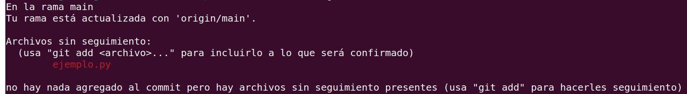
    <figcaption style="margin-top: 10px; font-size: 14px; color: #555;">Figura X. Descripción de figura.</figcaption>
  </figure>

Existen tres áreas donde pueden "estar" nuestras modificaciones y/o nuevos archivos:
1. **Directorio de trabajo**
2. **Área de stage** (stage area)
3. **Commit**
Tras hacer la primera modificación, el archivo ejemplo.py se encuentra en el **directorio de trabajo**. Para moverlo al **área de stage**:
```
git add ejemplo.py
```
Si queremos mover todo lo realizado, se utiliza un punto:
```
git add .
```
Volvemos a revisar el status y aparece lo siguiente:

<figure style="display: block; margin: 0 auto; max-width: 100%; text-align: center;">
    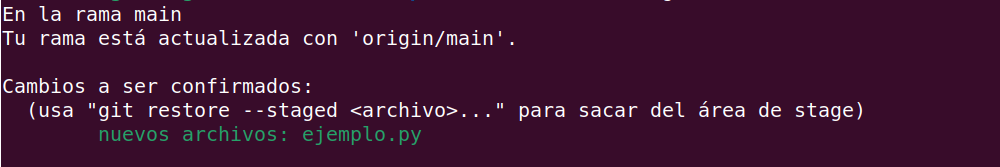
    <figcaption style="margin-top: 10px; font-size: 14px; color: #555;">Figura X. Descripción de figura.</figcaption>
  </figure>

Podemos modificar el archivo con ***vim***. Una vez hecho la modificación, revisamos de nuevo el status y aparece lo siguiente:

<figure style="display: block; margin: 0 auto; max-width: 100%; text-align: center;">
    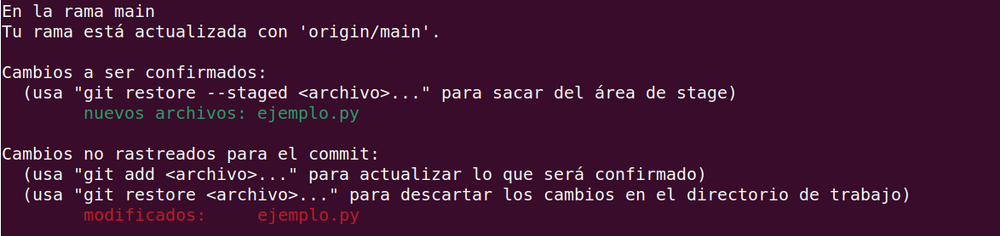
    <figcaption style="margin-top: 10px; font-size: 14px; color: #555;">Figura X. Descripción de figura.</figcaption>
  </figure>

Para que los cambios realizados al archivo ejemplo.py estén en el **área de stage**, usamos de nuevo el comando ***git add***. Aparece lo siguiente:

<figure style="display: block; margin: 0 auto; max-width: 100%; text-align: center;">
    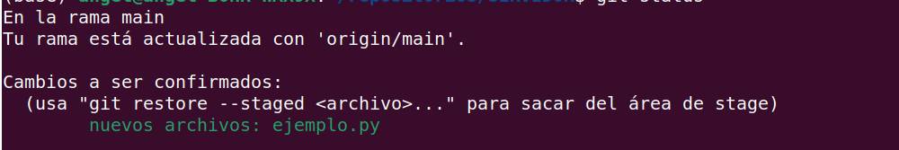
    <figcaption style="margin-top: 10px; font-size: 14px; color: #555;">Figura X. Descripción de figura.</figcaption>
  </figure>

Por último, para mover el archivo ejemplo.py al **commit**:
```
git commit
```
Se abrirá un archivo donde podemos poner **detalles** de los cambios realizados. Una vez guardados los cambios aparece lo siguiente:

<figure style="display: block; margin: 0 auto; max-width: 100%; text-align: center;">
    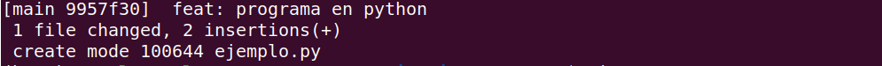
    <figcaption style="margin-top: 10px; font-size: 14px; color: #555;">Figura X. Descripción de figura.</figcaption>
  </figure>

Si revisamos de nuevo el status:

<figure style="display: block; margin: 0 auto; max-width: 100%; text-align: center;">
    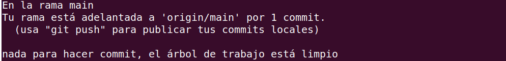
    <figcaption style="margin-top: 10px; font-size: 14px; color: #555;">Figura X. Descripción de figura.</figcaption>
  </figure>

Si queremos ver un **registro** de todos los cambios hechos en el repositorio:
```
git log
```

<figure style="display: block; margin: 0 auto; max-width: 100%; text-align: center;">
    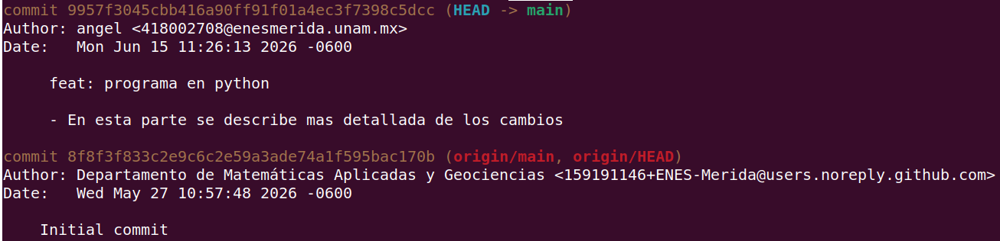
    <figcaption style="margin-top: 10px; font-size: 14px; color: #555;">Figura X. Descripción de figura.</figcaption>
  </figure>

 Los código alfanuméricos largos en color café son números **hash**, y son identificadores únicos de cada cambio realizado. 

Para **subir** los cambios a la nube:
```
git push origin main
```

<figure style="display: block; margin: 0 auto; max-width: 100%; text-align: center;">
    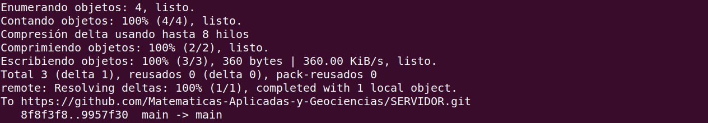
    <figcaption style="margin-top: 10px; font-size: 14px; color: #555;">Figura X. Descripción de figura.</figcaption>
  </figure>
 
 Para **bajar** los cambios hechos por otras personas:
```
 git pull
```

<figure style="display: block; margin: 0 auto; max-width: 100%; text-align: center;">
    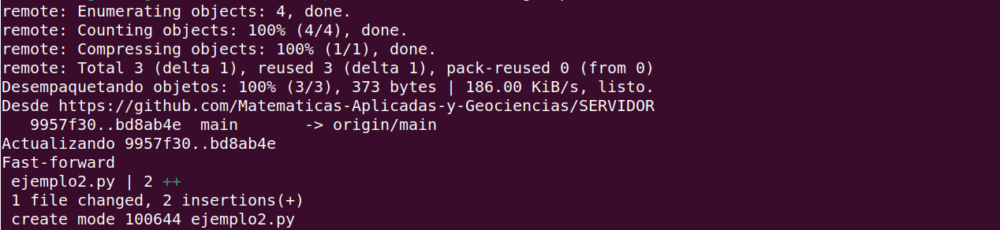
    <figcaption style="margin-top: 10px; font-size: 14px; color: #555;">Figura X. Descripción de figura.</figcaption>
  </figure>

Para regresar a un commit anterior o cambiar de ramas:
```
git checkout "insertar número hash"
```
Ejemplo:

<figure style="display: block; margin: 0 auto; max-width: 100%; text-align: center;">
    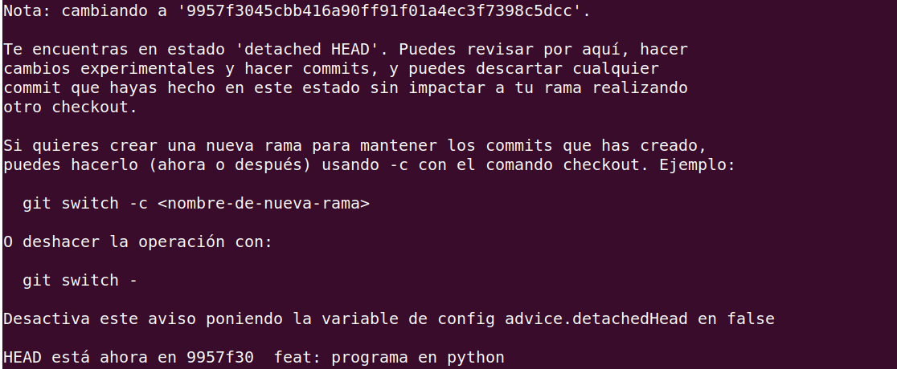
    <figcaption style="margin-top: 10px; font-size: 14px; color: #555;">Figura X. Descripción de figura.</figcaption>
  </figure>

Si queremos ver un archivo sin editarlo, usamos el comando ***cat***:
```
cat ejemplo.py
```
Para **regresar** un archivo al **área de trabajo** (siempre que no se haya subido al repositorio):
```
git restore --staged ejemplo.py
```

### Creación de ramas
Se pueden crear **ramas** de **main**. Para visualizar todas las ramas:
```
git log --oneline --graph --decorate
```
**NOTA**: las ramas se ven en la terminal como la imagen de abajo, pero girado hacia la izquierda.

<figure style="display: block; margin: 0 auto; max-width: 100%; text-align: center;">
    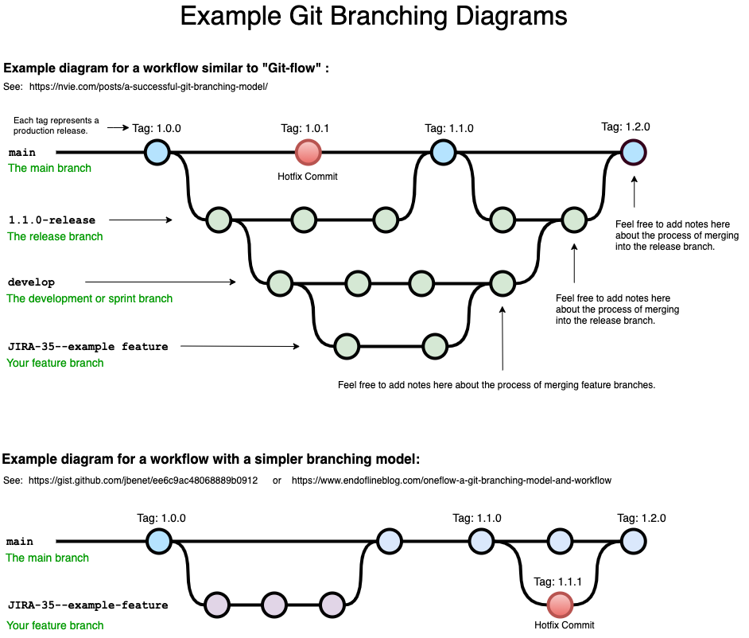
    <figcaption style="margin-top: 10px; font-size: 14px; color: #555;">Figura X. Descripción de figura.</figcaption>
  </figure>

Para ver en cuál rama estamos:
```
git branch
```

Para la creación de ramas, primero vamos al reservorio de SERVIDOR en la web de Github y creamos un nuevo "**Issue**", lo asignamos a nosotros, guardamos y le damos clic a crear rama. Copiamos el **código** y lo ejecutamos en la terminal. Por ejemplo, para la nueva rama "crear nuevo programa en python":
```
git fetch origin
git checkout 1-crear-nuevo-programa-en-python
```

<figure style="display: block; margin: 0 auto; max-width: 100%; text-align: center;">
    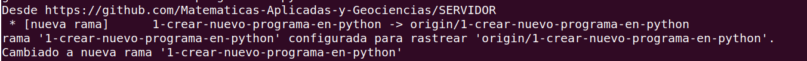
    <figcaption style="margin-top: 10px; font-size: 14px; color: #555;">Figura X. Descripción de figura.</figcaption>
  </figure>

Al ejecutarlo, automáticamente nos cambia a la nueva rama, lo que se puede corroborar con ***git branch***. Una vez se hagan las ediciones correspondientes, se sube la rama al repositorio:
```
git push origin 1-crear-nuevo-programa-en-python
```
==**IMPORTANTE**: Después de este paso hay que ir al reservorio web y hacer un "**Pull request**" dirigido al profesor, quien revisará los cambios y decidirá si la rama se incluirá al main. Si acepta, podemos bajar el reservorio ya actualizado y las ramas se verían así:==

<figure style="display: block; margin: 0 auto; max-width: 100%; text-align: center;">
    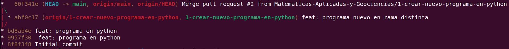
    <figcaption style="margin-top: 10px; font-size: 14px; color: #555;">Figura X. Descripción de figura.</figcaption>
  </figure>

Para **eliminar** una rama:
```
git branch -D 1-crear-nuevo-programa-en-python
```

---
Regresa al área de stage:

```
git reset --soft HEAD-1
```
Regresa al directorio de trabajo:

```
git reset --hard HEAD-1
```


