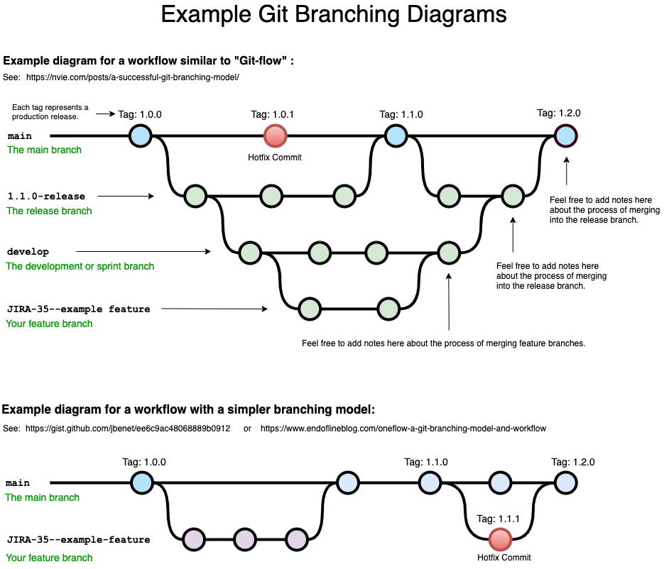

# Git y Github

<!--
Correcciones:
- Uniformizar el tamaño de las imágenes
- Traducir la imagen que tiene inglés al español
- Mejorar la redacción (escribir en tercera persona)
- Investigar cómo poner salidas de terminal con css y html en vez de las imágenes
-->

## Introducción

¿Quién ha tenido una carpeta con archivos llamados <em>"final"</em>, <em>"final2"</em> y <em>"final_ahora_sí"</em>? Quizás te ha pasado: estás trabajando en un proyecto importante (digamos, un código) y cada vez que le realizas un cambio sustancial, lo respaldas haciendo una copia del mismo, por si necesitas regresar a la versión anterior en caso de que las cosas se rompan o no funcionen.
 

El problema surge cuando dos semanas y 10 copias después, el código ya no corre. Sabes que la versión que servía existe en algún lado, pero no sabes si es <em>"script_bueno.py"</em>, <em>"script_bueno_2.py"</em> o <em>"script_ok_final.py"</em> (Figura 1). Recuerdas que hace una semana decidiste limpiar la carpeta de tu proyecto y borraste las versiones antiguas, y sí, entre ellas estaba aquella función que habías arreglado a las 2 de mañana. No hay papalera que te salve, y nadie recuerda qué se cambio ni cuando. Una tragedia. ¿La solución?

<figure style="display: block; margin: 0 auto; max-width: 100%; text-align: center;">
    
    <figcaption style="margin-top: 10px; font-size: 14px; color: #555;">Figura 1. Sin control de versiones, el proyecto se llena de copias y nadie sabe cuál funciona, qué cambió ni qué se perdió.</figcaption>
  </figure>

## Git

Es un <b>sistema de control de versiones</b> de código abierto que <em>registra los cambios en los archivos</em>. Te permite trabajar en tu propia copia de un proyecto, registrar un historial de tus cambios y fusionar tu trabajo con los cambios de otras personas de forma segura y eficiente (Figura 2).

<figure style="display: block; margin: 0 auto; max-width: 100%; text-align: center;">
    
    <figcaption style="margin-top: 10px; font-size: 14px; color: #555;">Figura 2. Logo oficial de Git.</figcaption>
  </figure>

### Capturas

Git piensa en sus datos como una serie de <em>capturas de un sistema de archivos en miniatura</em> (Figura 3). Cada vez que haces un <b>commit</b> (salvar el estado de tu proyecto), Git básicamente toma una imagen de cómo lucen todos tus archivos en ese momento y almacena una referencia a esa captura. Para ser eficiente, si un archivo no ha cambiado, Git guarda un enlace al archivo idéntico preexistente, en vez de almacenarlo de nuevo. 

<figure style="display: block; margin: 0 auto; max-width: 100%; text-align: center;">
    
    <figcaption style="margin-top: 10px; font-size: 14px; color: #555;">Figura 3. Almacenando datos como capturas de un proyecto a través del tiempo. Las figuras con marco punteado representan los archivos que no fueron modificados en cada versión.</figcaption>
  </figure>

### Casi toda operación es local

La mayoría de las operaciones en Git necesitan sólo archivos y recursos locales para operar; generalmente no se necesita ninguna información de otra computadora en tu red. Esta característica le concede a Git una <b>velocidad</b> notable. Debido a que tienes el historial completo de tu proyecto justo en tu disco local, la mayoría de las operaciones parecen casi instantáneas (Figura 4).

<figure style="display: block; margin: 0 auto; max-width: 100%; text-align: center;">
    
    <figcaption style="margin-top: 10px; font-size: 14px; color: #555;">Figura 4. Git conserva el historial completo en tu disco local, por lo que casi todas las operaciones son inmediatas y no dependen de la red.</figcaption>
  </figure>

### A Git no se le escapa nada

Todo cambio en Git es verificado mediante sumas (<em>checksummed</em>) antes de ser almacenado y luego es referido por esa suma verificada. ¿Qué quiere decir? Significa que a cada cambio se le asigna un <b>hash</b>, una cadena de 40 caracteres hexadesimales calculada a partir del contenido del archivo o la estructura del directorio de Git (Figura 5).

<figure style="display: block; margin: 0 auto; max-width: 100%; text-align: center;">
    
    <figcaption style="margin-top: 10px; font-size: 14px; color: #555;">Figura 5. Git calcula un hash SHA-1 de 40 caracteres hexadecimales a partir del contenido de cada objeto y lo usa como su identificador.</figcaption>
  </figure>

### Los tres estados

Git tiene tres estados principales en los que pueden residir tus archivos:

<ul>
  <li><b>modified</b> (modificado): significa que has modificado el archivo pero no lo has confirmado en tu base de datos aún.</li>
  <li><b>staged</b> (indexado): significa que has marcado un archivo modificado en su versión actual para ir al siguiente estado.</li>
  <li><b>commited</b> (confirmado): significa que los datos están almacenados con seguridad en tu base de datos local.</li>
</ul>

### Los tres secciones

Esto nos lleva  las tres secciones principales de un proyecto de Git:

<ul>
  <li><b>Directorio de trabajo</b>: es donde llevas a cabo las modificaciones. Contiene los cambios que no han sido confirmados aún.</li>
  <li><b>Área de stage</b>: contiene los cambios que quieres que formen parte de su siguiente commit.</li>
  <li><b>Directorio Git</b>: contiene los cambios ya confirmados en forma de capturas permanentes.</li>
</ul>

Juntando estos dos elementos, el flujo de trabajo básico en Git es similar a como sigue: los archivos modificados (estado <b>modified</b>) en el <b>directorio de trabajo</b> son seleccionados para pasar al <b>área de stage</b> (estado <b>staged</b>) y luego son confirmados para ser almacenados  de forma permanente en el <b>directorio Git</b> (estado <b>commited</b>) (Figura 6).
 

<figure style="display: block; margin: 0 auto; max-width: 100%; text-align: center;">
    
    <figcaption style="margin-top: 10px; font-size: 14px; color: #555;">Figura 6. Flujo de trabajo en Git.</figcaption>
  </figure>

 

Basta de teoría, ahora sabemos lo suficiente para pasar a la acción y empezar a usar Git.

## Instalación de Git

<ul class="nav nav-tabs" role="tablist">
  <li role="presentation" class="active"><a href="#windows_git_install" aria-controls="windows" role="tab" data-toggle="tab">Windows</a></li>
  <li role="presentation"><a href="#linux_git_install" aria-controls="linux" role="tab" data-toggle="tab">Linux</a></li>
</ul>

 <!-- SECCION WINDOWS-->

  

    
    
 

    
Desde el menú de inicio, abre el <b>PowerShell</b> con clic derecho y selecciona la opción <b>Ejecutar como administrador</b>. Luego ejecuta el siguiente comando:

    <pre><code>winget install --id Git.Git -e --source winget</code></pre>

    El sistema descargará el ejecutable y te preguntará si quieres abrir la aplicación como adiminstrador. Dale clic en <b>Aceptar</b> y se abrirá la <b>ventana de instalación</b>. Cuando termine de instalar, cierra y abre el <b>PowerShell</b> para que reconozca el comando, y verifica con:

    <pre><code>git --version</code></pre>

    
Te aparecerá lo siguiente:

    

    <pre>git version 2.55.0.windows.5</pre>

    
 

    
¡Listo! Haz instalado Git en tu computadora.

  

 <!-- SECCION LINUX -->

    

  
    
 

    
<em>Nota</em>: aplica para distribuciones basadas en Debian (Ubuntu, MX Linux, Kali Linux, etc.).

    
Abre una <b>terminal</b> y ejecuta lo siguiente:

    <pre><code>sudo apt update
sudo apt install git</code></pre>

    <h4>Explicación</h4>    

    
<code>sudo apt uptate</code> <em>actualiza la lista de paquetes disponibles</em> de todo el sistema, pero no instala ni actualiza ningún programa. En nuestro caso particular, sólo lo usamos para obtener la última versión de git en el sistema. La instalación de git como tal se realiza con <code>sudo apt install git</code>, que al ejecutarlo aparecerá lo siguiente:

    

    <pre>Leyendo lista de paquetes... Hecho
Creando árbol de dependencias... Hecho
Leyendo la información de estado... Hecho
Se instalarán los siguientes paquetes adicionales:
  git-man
Paquetes sugeridos:
  git-daemon-run | git-daemon-sysvinit git-doc git-email git-gui gitk gitweb
  git-cvs git-mediawiki git-svn
Se instalarán los siguientes paquetes NUEVOS:
  git
Se actualizarán los siguientes paquetes:
  git-man
1 actualizados, 1 nuevos se instalarán, 0 para eliminar y 159 no actualizados.
Se necesita descargar 4 781 kB de archivos.
Se utilizarán 22.2 MB de espacio de disco adicional después de esta operación.
¿Desea continuar? [S/n]</pre>
    
    

    
El sistema te preguntará si deseas continuar con la instalación de los paquetes enlistados. Escribe <b>s</b> y presiona <b>Enter</b> para confirmar.

    

    <pre>Des:1 http://archive.ubuntu.com/ubuntu noble-updates/main amd64 git-man all 1:2.43.0-1ubuntu7.4 [1 101 kB]
Des:2 http://archive.ubuntu.com/ubuntu noble-updates/main amd64 git amd64 1:2.43.0-1ubuntu7.4 [3 681 kB]
Descargados 4 781 kB en 6s (756 kB/s)                                               
(Leyendo la base de datos ... 308160 ficheros o directorios instalados actualmente.)
Preparando para desempaquetar .../git-man_1%3a2.43.0-1ubuntu7.4_all.deb ...
Desempaquetando git-man (1:2.43.0-1ubuntu7.4) sobre (1:2.43.0-1ubuntu7.3) ...
Seleccionando el paquete git previamente no seleccionado.
Preparando para desempaquetar .../git_1%3a2.43.0-1ubuntu7.4_amd64.deb ...
Desempaquetando git (1:2.43.0-1ubuntu7.4) ...
Configurando git-man (1:2.43.0-1ubuntu7.4) ...
Configurando git (1:2.43.0-1ubuntu7.4) ...
Procesando disparadores para man-db (2.12.0-4build2) ...
</pre>

    

    
Verifica si la instalación se realizó exitosamente:

    <pre><code>git --version</code></pre>

    
Te aparecerá lo siguiente:

    

     <pre>git version 2.43.0</pre>
    

  
    
¡Listo! Haz instalado Git en tu computadora.

  

## Configuración de Git

El siguiente paso importante es configurar Git con los datos necesarios para usarlo.

<h4>Nombre de usuario</h4>

Se asigna con el siguiente comando, cambiando <code>tu nombre</code> por el nombre que prefieras para tu usuario:

<pre><code>git config --global user.name tu_nombre
</code></pre>

<h4>Correo electrónico</h4>

Cambia <code>tu@correo.com</code> por el correo de tu preferencia:

<pre><code>git config --global user.email tu@correo.com
</code></pre>

<h4>Editor de texto</h4>

Cambia <code>tu_editor</code> por el nombre del editor de texto que sueles usar:

<pre><code>git config --global core.editor tu_editor
</code></pre>

<h4>Rama principal</h4>

Vamos a utilizar la rama <code>main</code>:

<pre><code>git config --global init.defaultBranch main
</code></pre>

Para ver las **configuraciones** de git en el dispositivo (nombre, correo, editor de texto):

<pre><code>git config -l</code></pre>

## Obtención de un repositorio de Git

Normalmente se obtiene un repositorio de Git de una de estas dos maneras:

<ol>
  <li>Puedes tomar un directorio local que actualmente no está bajo control de versiones y convertirlo en un repositorio de Git, o</li>
  <li>Puedes clonar un repositorio de Git existente desde otro lugar.</li>
</ol>

Aquí vamos a explorar la segunda opción con la ayuda de <b>GitHub</b>.

## GitHub

Es una <b>plataforma</b> que <em>respalda todo tu proceso</em> de desarrollo de software, desde la planificación del trabajo hasta el despliegue y la operación del software (Figura 7).

<figure style="display: block; margin: 0 auto; max-width: 100%; text-align: center;">
    
    <figcaption style="margin-top: 10px; font-size: 14px; color: #555;">Figura 7. Logo oficial de GitHub.</figcaption>
  </figure>

### Git y GitHub

<b>GitHub</b> se contruye sobre <b>Git</b> alojando tus proyectos de Git, llamados <b>repositorios</b>, en la nube, además de añadir herramientas de planificación y colaboración que facilitan el trabajo en equipos (Figura 8).

<figure style="display: block; margin: 0 auto; max-width: 100%; text-align: center;">
    
    <figcaption style="margin-top: 10px; font-size: 14px; color: #555;">Figura 8. Cada desarrollador trabaja en su repositorio local y lo sincroniza con GitHub.</figcaption>
  </figure>

## Creación de repositorio en Github

Primero, crea una cuenta de Github mediante en siguiente enlace: <a href="https://github.com/signup?ref_cta=Sign+up&ref_loc=header+logged+out&ref_page=%2F&source=header-home" target="_blank" rel="noopener noreferrer">crear cuenta de Github</a>. Posteriormente, sigue las indicaciones como se muestran a continuación:

 
\"New repository\"."},
    {"src": "../../images/creacion_repositorio_3.png", "title": "Paso 3", "desc": "Define el nombre de tu repositorio."},
    {"src": "../../images/creacion_repositorio_4.png", "title": "Paso 4", "desc": "Añade una descripción."},
    {"src": "../../images/creacion_repositorio_5.png", "title": "Paso 5", "desc": "Escoge la visibilidad."},
    {"src": "../../images/creacion_repositorio_6.png", "title": "Paso 6", "desc": "Añade un \"READ ME\"."},
    {"src": "../../images/creacion_repositorio_7.png", "title": "Paso 7", "desc": "Deja \"No.gitignore\" por defecto."},
    {"src": "../../images/creacion_repositorio_8.png", "title": "Paso 8", "desc": "Selecciona la licencia \"GNU General Public License v3.0\"."},
    {"src": "../../images/creacion_repositorio_9.png", "title": "Paso 9", "desc": "Dale clic en \"Create repository\"."},
    {"src": "../../images/creacion_repositorio_10.png", "title": "Paso final", "desc": "¡Listo! Haz creado tu repositorio en GitHub."}
    ]'>

¿Llegaste al paso final? ¡Felicidades! Haz creado tu primer repositorio en GitHub.

## Instalación de Github CLI 

<b>GitHub CLI</b> te permite usar Github directamente desde la línea de comandos de la terminal o el PowerShell. En particular, conecta la computadora con tu repositorio de Github en la nube.

<!-- CODIGO PARA SECCIONES WINDOWS Y LINUX -->

<ul class="nav nav-tabs" role="tablist">
  <li role="presentation" class="active"><a href="#windows_githubcli" aria-controls="windows" role="tab" data-toggle="tab">Windows</a></li>
  <li role="presentation"><a href="#linux_githubcli" aria-controls="linux" role="tab" data-toggle="tab">Linux</a></li>
</ul>

 <!-- SECCION WINDOWS-->

  

    
    
 

    
Abre el <b>PowerShell</b> y ejectua el siguiente comando:

    
    <pre><code>winget install --id GitHub.cli --source winget</code></pre>

    El sistema realizará el proceso de instalación. En algún punto te preguntará si quieres permitir que la aplicación realice cambios en tu dispositivo. Le das clic a <b>Sí</b>. Al final debe aparecer "Instalado correctamente".

    

    <pre>
Encontrado GitHub CLI [GitHub.cli] Versión 2.102.0 

El propietario de esta aplicación le concede una licencia. 

Microsoft no es responsable, ni tampoco concede ninguna licencia de paquetes de terceros. 

El hash del instalador se verificó correctamente 

Iniciando instalación de paquete... 

Instalado correctamente</pre>
    

    
Por último, cierra y abre el powershell para finalizar la instalación.

 
  

 <!-- SECCION LINUX -->

  

    
    
 

    
Abre una <b>terminal</b> y ejecuta el siguiente conjunto de comandos:

    
    <pre><code>(type -p wget >/dev/null || (sudo apt update && sudo apt install wget -y)) \
	&& sudo mkdir -p -m 755 /etc/apt/keyrings \
	&& out=$(mktemp) && wget -nv -O$out https://cli.github.com/packages/githubcli-archive-keyring.gpg \
	&& cat $out | sudo tee /etc/apt/keyrings/githubcli-archive-keyring.gpg > /dev/null \
	&& sudo chmod go+r /etc/apt/keyrings/githubcli-archive-keyring.gpg \
	&& sudo mkdir -p -m 755 /etc/apt/sources.list.d \
	&& echo "deb [arch=$(dpkg --print-architecture) signed-by=/etc/apt/keyrings/githubcli-archive-keyring.gpg] https://cli.github.com/packages stable main" | sudo tee /etc/apt/sources.list.d/github-cli.list > /dev/null \
	&& sudo apt update \
	&& sudo apt install gh -y</code></pre>

    
El sistema te pedirá que escribas tu contraseña del sistema. Una vez la escribas, todo el proceso puede tardar un poco, así que sé paciente. Al final debe salir lo siguiente:

    

    <pre>Leyendo lista de paquetes... Hecho                                                   
Creando árbol de dependencias... Hecho
Leyendo la información de estado... Hecho
Se instalarán los siguientes paquetes NUEVOS:
  gh
0 actualizados, 1 nuevos se instalarán, 0 para eliminar y 103 no actualizados.
Se necesita descargar 15.1 MB de archivos.
Se utilizarán 41.5 MB de espacio de disco adicional después de esta operación.
Des:1 https://cli.github.com/packages stable/main amd64 gh amd64 2.103.0 [15.1 MB]
Descargados 15.1 MB en 13s (1 181 kB/s)                                              
Seleccionando el paquete gh previamente no seleccionado.
(Leyendo la base de datos ... 309045 ficheros o directorios instalados actualmente.)
Preparando para desempaquetar .../archives/gh_2.103.0_amd64.deb ...
Desempaquetando gh (2.103.0) ...
Configurando gh (2.103.0) ...
Procesando disparadores para man-db (2.12.0-4build2) ...</pre>
    

    
Verifica que la instalación se realizó correctamente:

    <pre><code>gh --version</code></pre>

    
Te aparecerá algo parecido a lo siguiente:

    

    <pre>gh version 2.103.0 (2026-10-21)
https://github.com/cli/cli/releases/tag/v2.103.0</pre>
    

    
¡Listo! Haz instalado GitHub CLI en tu computadora.

  
  

## Inicio de sesión con GitHub CLI

<!-- CODIGO PARA SECCIONES WINDOWS Y LINUX -->

<ul class="nav nav-tabs" role="tablist">
  <li role="presentation" class="active"><a href="#windows_sesion_gh" aria-controls="windows" role="tab" data-toggle="tab">Windows</a></li>
  <li role="presentation"><a href="#linux_sesion_gh" aria-controls="linux" role="tab" data-toggle="tab">Linux</a></li>
</ul>

 <!-- SECCION WINDOWS-->

  

  
    
 

    
Utiliza el comando <code>gh</code> (de GitHub CLI) como sigue:

    <pre><code>gh auth login</code></pre>

    
El sistema te preguntará dónde usas GitHub. Selecciona <b>GitHub.com</b> con las teclas de flecha arriba y abajo y presionar Enter.

    

    <pre>? Where do you use GitHub?  [Use arrows to move, type to filter]
> GitHub.com
  Other</pre>

    

    
Luego te pregunta cómo te gustaría autentificar tu cuenta de GitHub. Selecciona la opción <b>Login with a web browser</b>.

    

    <pre>? How would you like to authenticate GitHub CLI?  [Use arrows to move, type to filter]
> Login with a web browser
  Paste an authentication token</pre>
    

    
La siguiente opción es sobre el protecolo web preferido para usar Git. Selecciona <b>HTTPS</b>.

    

    <pre>? What is your preferred protocol for Git operations on this host?  [Use arrows to move, type to filter]
> HTTPS
  SSH</pre>
    

    
Posteriormente te pregunta si quieres autentificar Git con tus credenciales de Github. Escribe <b>y</b>.

    

    <pre>? Authenticate Git with your GitHub credentials? (Y/n) </pre>
    

    
Te mostrará tu código de una sola vez (<b>one-time code</b>): un código alfanumérico de 8 dígitos. Lo vas a necesitar después. Para continuar con el inicio de sesión, presiona Enter.

    

    <pre>! First copy your one-time code: XAXX-XXDX
Press Enter to open https://github.com/login/device in your browser...</pre>
    

    
Te redigirá a la <b>página web</b> de inicio de sesión en GitHub. Inicia sesión con los datos que usaste al crear tu repositorio. Una vez hecho esto, te pedirá el <b>código</b> de una sola vez; cópialo desde del PowerShell y pégalo donde te lo solicita. Luego haz clic en <b>Continue</b>.

    <figure style="display: block; margin: 0 auto; max-width: 100%; text-align: center;">
    
    <figcaption style="margin-top: 10px; font-size: 14px; color: #555;">Figura 1. Pantalla donde se introduce el código de una sola vez.</figcaption>
    </figure>

    
 

    
Te saldrá otra pantalla donde se muestra un resumen de todo lo que podrá acceder Github CLI de tu cuenta de GitHub. Para autorizar el acceso le das clic en <b>authorize github</b>. Te saldrá una pantalla con el mensaje "Congratulations, you're all set!"; ciérrala para continuar el proceso. En el PowerShell te aparecerá lo siguiente:

    

    <pre>✓ Authentication complete.
- gh config set -h github.com git_protocol https
✓ Configured git protocol
✓ Logged in as <b>tu-nombre-de-usuario</b></pre>
    

    
¡Listo! Haz iniciado sesión de GitHub en tu línea de comandos.

  

 <!-- SECCION LINUX -->

  

       
 

    
Utiliza el comando <code>gh</code> (de GitHub CLI) como sigue:

    <pre><code>gh auth login</code></pre>

    
El sistema te preguntará dónde usas GitHub. Selecciona <b>GitHub.com</b> con las teclas de flecha arriba y abajo y presionar Enter.

    

    <pre>? Where do you use GitHub?  [Use arrows to move, type to filter]
> GitHub.com
  Other</pre>

    

    
Luego te pregunta cómo te gustaría autentificar tu cuenta de GitHub. Selecciona la opción <b>Login with a web browser</b>.

    

    <pre>? How would you like to authenticate GitHub CLI?  [Use arrows to move, type to filter]
> Login with a web browser
  Paste an authentication token</pre>
    

    
La siguiente opción es sobre el protecolo web preferido para usar Git. Selecciona <b>HTTPS</b>.

    

    <pre>? What is your preferred protocol for Git operations on this host?  [Use arrows to move, type to filter]
> HTTPS
  SSH</pre>
    

    
Posteriormente te pregunta si quieres autentificar Git con tus credenciales de Github. Escribe <b>y</b>.

    

    <pre>? Authenticate Git with your GitHub credentials? (Y/n) </pre>
    

    
Te mostrará tu código de una sola vez (<b>one-time code</b>): un código alfanumérico de 8 dígitos. Lo vas a necesitar después. Para continuar con el inicio de sesión, presiona Enter.

    

    <pre>! First copy your one-time code: XAXX-XXDX
Press Enter to open https://github.com/login/device in your browser...</pre>
    

    
Te redigirá a la <b>página web</b> de inicio de sesión en GitHub. Inicia sesión con los datos que usaste al crear tu repositorio. Una vez hecho esto, te pedirá el <b>código</b> de una sola vez; cópialo desde del PowerShell y pégalo donde te lo solicita. Luego haz clic en <b>Continue</b>.

    <figure style="display: block; margin: 0 auto; max-width: 100%; text-align: center;">
    
    <figcaption style="margin-top: 10px; font-size: 14px; color: #555;">Figura 1. Pantalla donde se introduce el código de una sola vez.</figcaption>
    </figure>

    
 

    
Te saldrá otra pantalla donde se muestra un resumen de todo lo que podrá acceder Github CLI de tu cuenta de GitHub. Para autorizar el acceso le das clic en <b>authorize github</b>. Te saldrá una pantalla con el mensaje "Congratulations, you're all set!"; ciérrala para continuar el proceso. En el PowerShell te aparecerá lo siguiente:

    

    <pre>✓ Authentication complete.
- gh config set -h github.com git_protocol https
✓ Configured git protocol
✓ Logged in as <b>tu-nombre-de-usuario</b></pre>
    

    
¡Listo! Haz iniciado sesión de GitHub en tu línea de comandos.
   
  

## Clonación de un repositorio a tu computadora

<!-- CODIGO PARA SECCIONES WINDOWS Y LINUX -->

<ul class="nav nav-tabs" role="tablist">
  <li role="presentation" class="active"><a href="#windows_clonacion" aria-controls="windows" role="tab" data-toggle="tab">Windows</a></li>
  <li role="presentation"><a href="#linux_clonacion" aria-controls="linux" role="tab" data-toggle="tab">Linux</a></li>
</ul>

 <!-- SECCION WINDOWS-->

  

  
  
 

    
Primero vamos a crear una carpeta en la raíz llamada <b>repositorios</b>, donde vamos a guardar el repositorio que creamos (y los repositorios futuros):
 

    <pre><code>cd
mkdir repositorios
cd repositorios</code></pre>

    
Ve a tu repositorio en <a href="https://github.com/" target="_blank" rel="noopener noreferrer">GitHub</a> y sigue los pasos siguientes: 

    
\"Code\"."},
      {"src": "../../images/clonar_repositorio_3.png", "title": "Paso 3: opción 1", "desc": "En la sección HTTPS copia el URL y continúa en la sección Opción 1."},
      {"src": "../../images/clonar_repositorio_4.png", "title": "Paso 3: opción 2", "desc": "En la sección GitHub CLI copia el comando y continúa en Opción 2."}]'>
    

    <h4>Opción 1</h4>    

    
Ejecuta el siguiente comando, cambiando <code>url_copiado_de_HTTPS</code> por el URL que copiaste:

    <pre><code>git clone url_copiado_de_HTTPS</code></pre>

    <h4>Opción 2</h4>
    
    
Ejecuta el comando que copiaste y listo.

    
En cualquier de las dos opciones, te saldrá algo parecido a esto:

    

    <pre>Clonando en 'isobit_repositorio_personal'...
remote: Enumerating objects: 4, done.
remote: Counting objects: 100% (4/4), done.
remote: Compressing objects: 100% (4/4), done.
remote: Total 4 (delta 0), reused 0 (delta 0), pack-reused 0 (from 0)
Recibiendo objetos: 100% (4/4), 12.78 KiB | 12.78 MiB/s, listo.</pre>
    

    
¡Felicidades! Haz creado una carpeta con el nombre de tu repositorio que contiene todo el contenido de tu repositorio de GitHub. Para verificar que sí se creo la carpeta, sólo ejecuta el comando <code>dir</code>.
 

  

 <!-- SECCION LINUX -->

  

  
    
 

    
Primero vamos a crear una carpeta en la raíz llamada <b>repositorios</b>, donde vamos a guardar el repositorio que creamos (y los repositorios futuros):
 

    <pre><code>cd
mkdir repositorios
cd repositorios/</code></pre>

    
Ve a tu repositorio en <a href="https://github.com/" target="_blank" rel="noopener noreferrer">GitHub</a> y sigue los pasos siguientes: 

    
\"Code\"."},
      {"src": "../../images/clonar_repositorio_3.png", "title": "Paso 3: opción 1", "desc": "En la sección HTTPS copia el URL y continúa en la sección Opción 1."},
      {"src": "../../images/clonar_repositorio_4.png", "title": "Paso 3: opción 2", "desc": "En la sección GitHub CLI copia el comando y continúa en Opción 2."}]'>
    

    <h4>Opción 1</h4>    

    
Ejecuta el siguiente comando, cambiando <code>url_copiado_de_HTTPS</code> por el URL que copiaste:

    <pre><code>git clone url_copiado_de_HTTPS</code></pre>

    <h4>Opción 2</h4>
    
    
Ejecuta el comando que copiaste y listo.

    
En cualquier de las dos opciones, te saldrá algo parecido a esto:

    

    <pre>Clonando en 'isobit_repositorio_personal'...
remote: Enumerating objects: 4, done.
remote: Counting objects: 100% (4/4), done.
remote: Compressing objects: 100% (4/4), done.
remote: Total 4 (delta 0), reused 0 (delta 0), pack-reused 0 (from 0)
Recibiendo objetos: 100% (4/4), 12.78 KiB | 12.78 MiB/s, listo.</pre>
    

    
¡Felicidades! Haz creado una carpeta con el nombre de tu repositorio que contiene todo el contenido de tu repositorio de GitHub. Para verificar que sí se creo la carpeta, sólo ejecuta el comando <code>ls</code>.
 

  

## Tutorial básico de Git y GitHub

Cada archivo de tu <b>directorio de trabajo</b> puede estar en uno de los dos estados siguentes:

<ul>
  <li><b>rastreados</b> (tracked): son los archivos que estaban en tu última captura, así como cualquier archivo recién promovido al área de stage. En resumen, son los archivos que Git conoce. Cuando clonas un repositorio por primera vez, todos tus archivos estarán rastreados.</li>
  <li><b>sin seguimiento</b> (untracked): cualquier archivo que no estaba en tu última captura y que no está en tu área de stage. Son archivos que recién has agregado a tu repositorio.</li>
</ul>

<!-- CODIGO PARA SECCIONES WINDOWS Y LINUX -->

<ul class="nav nav-tabs" role="tablist">
  <li role="presentation" class="active"><a href="#windows_tutorial" aria-controls="windows" role="tab" data-toggle="tab">Windows</a></li>
  <li role="presentation"><a href="#linux_tutorial" aria-controls="linux" role="tab" data-toggle="tab">Linux</a></li>
</ul>

 <!-- SECCION WINDOWS-->

  

  
    
 

    
Primero entra a la carpeta con el nombre de tu repositorio, cambiando <code>carpeta_repositorio</code> por el nombre tu carpeta:

    <pre><code>cd carpeta_repositorio</code></pre>

    <h4>Revisar el estado de tus archivos</h4>

    
La herramienta principal que se usa para determinar qué archivos están en qué estado es el comando <code>git status</code>. Si ejecutas este comando después de una clonación, deberías ver algo como esto:

    

  
    <pre>En la rama main
Tu rama está actualizada con ‘origin/main’.

nada para hacer commit, el árbol de trabajo está limpio</pre>
    

    
Esto significa que tienes un directorio de trabajo limpio; en otras palabras, ninguno de tus archivos rastreados han sido modificados. Por otra parte, no te muestra ningún archivo sin rastrear, o de lo contrario estaría listado aquí. Finalmente el comando te dice en cual rama estás y te informa que no ha divergido de la misma rama en el servidor. Por ahora la rama por defecto es <code>main</code>.

    
Ahora vamos a agregar un nuevo archivo a tu proyecto:

    
    <pre><code>New-Item "ejemplo.py" -ItemType File</code></pre>

    
Dado que el archivo no existía antes, si corres de nuevo el comando <code>git status</code>, verás tu archivo sin rastrear como sigue:

    

    <pre>En la rama main
Tu rama está actualizada con ‘origin/main’.

Archivos sin seguimiento:
  (usa “git add <archivo>...” para incluirlos en lo que será confirmado)
      ejemplo.py

no hay nada agregado para hacer commit, pero hay archivos sin seguimiento presentes (usa “git add” para hacerles seguimiento)</pre>
    

    
Puedes ver que tu nuevo archivo <b>ejemplo.py</b> no tiene seguimiento, porque aparece bajo el encabezado "Archivos sin seguimiento" en la salida del status. Git no dará seguimiento a tu archivo en el siguiente commit hasta que se lo indiques explícitamente.

    <h4>Seguimiento de archivos nuevos</h4>

    
Para comenzar a darle seguimiento a un archivo nuevo, se usa el comando <code>git add</code>:

    <pre><code>git add ejemplo.py</code></pre>

    
Si corres el comando <code>git status</code> de nuevo, verás que archivo <b>ejemplo.py</b> está ahora con seguimiento y en el <b>área de stage</b>, listo para para ser confirmado en el siguiente commit:

    

    <pre>En la rama main
Tu rama está actualizada con ‘origin/main’.

Cambios a ser confirmados:
  (usa “git restore --staged <archivo>...” para sacarlos del área de stage)
      nuevos archivos: ejemplo.py</pre>

    

    
Puedes saber que está en el área de stage porque aparece bajo el encabezado "Cambios a ser confirmados". Si haces commit en este momento, la versión del archivo que existía cuando ejecutaste <code>git add</code> es la que quedará en el commit posterior.

    <h4>Mover archivos modificados al área de stage</h4>

    
Vamos a modificar un archivo que ya tenía seguimiento, por ejemplo, el archivo <b>README.md</b>. Si lo modificas y luego ejecutas el comando <code>git status</code>, obtendrás algo que se ve así:

    

      
    <pre>En la rama main
Tu rama está actualizada con ‘origin/main’.

Cambios a ser confirmados:
  (usa “git reset HEAD <archivo>...” para sacarlos del área de preparación)

      nuevos archivos: ejemplo.py

Cambios no rastreados para el commit:
  (usa “git add <archivo>...” para actualizar lo que será confirmado)
  (usa “git checkout -- <archivo>...” para descartar los cambios en el directorio de trabajo)

      modificados:    README.md</pre>

    

    
El archivo <b>README.md</b> aparece bajo la sección llamada "Cambios no rastreados pra el commit", lo que significa que un archivo con seguimiento ha sido modificado en el directorio de trabajo, pero todavía no ha sido movido al área de stage. Para hacerlo, ejecuta el comando <code>git add</code>:

    <pre><code>git add README.md</code></pre>

    
Ejecutamos <code>git status</code> de nuevo:

    

    
    <pre>En la rama main
Tu rama está actualizada con ‘origin/main’.

Cambios a ser confirmados:
  (usa “git reset HEAD <archivo>...” para sacarlos del área de preparación)
      nuevos archivos: ejemplo.py
      modificados: README.md</pre>
    
    

    
Ahora ambos archivos están en el área de stage y entrarán en tu próximo commit. En este punto, supón que recuerdas un pequeño cambio que quieres hacer en <b>README.md</b> antes de hacer commit. Lo abres de nuevo, haces ese cambio y ya estás listo para hacer este commit. Sim embargo, ejecutemos <b>git status</b> una vez más:

    

    <pre>En la rama main
Tu rama está actualizada con ‘origin/main’.

Cambios a ser confirmados:
  (usa “git reset HEAD <archivo>...” para sacarlos del área de preparación)
      nuevos archivos: ejemplo.py
      modificados: README.md

Cambios no rastreados para el commit:
  (usa “git add <archivo>...” para actualizar lo que será confirmado)
  (usa “git checkout -- <archivo>...” para descartar los cambios en el directorio de trabajo)

      modificados: README.md</pre>    

    

    
¿Qué ocurrió? Ahora README.md aparece listado en "Cambios para ser confirmados" y "Cambios no rastreados por el commit" al mismo tiempo. ¿Cómo es posible? Resulta que la versión del archivo que entrará al commit es la que estaba cuando se ejecutó <code>git add</code>, pero la versión que incluye las últimas modificaciones no ha sido rastreada aún, por lo que es necesario ejecutar <code>git add</code> de nuevo para que meter al commit los últimos cambios.

    <h4>Confirmar tus cambios (hacer commit)</h4>

    
Ahora que tu área de stage contiene exactamente lo que quieres, puedes hacer commit de tus cambios con el comando <code>git commit</code>:

    <pre><code>git commit</code></pre>

    
Al hacer esto, se abre el editor de tu elección. El editor muestra el siguiente texto:

    

  <pre>

# Por favor, escribe el mensaje de commit para tus cambios. Las líneas que empiezan 
# con '#' serán ignoradas, y un mensaje vacío cancela el commit.
#
# En la rama main
# Tu rama está actualizada con ‘origin/master’.
#
# Cambios a ser confirmados:
#     nuevos archivos: ejemplo.py
#     modified: README.md
#
~
~
~
".git/COMMIT_EDITMSG" 9L, 283C</pre>  
    

    
Puedes ver que el mensaje de commit predeterminado contiene la salida más reciente del comando <code>git status</code> comentada, y una línea vacía en la parte superior. Puede eliminar esots comentario y escribir tu mensaje de commit, o puedes dejarlos ahí para ayudarte a recordar qué estás confirmando.

    
Cuando sales del editor, Git crea tu commit con ese mensaje:

    

    <pre>[main aaab45e] mensaje de commit
 2 archivos modificados, 2 inserciones(+)</pre>
    
 

    
Alternativamente, puedes escribir tu mensaje de commit en la línea de comando con el comando <code>commit -m</code> de la siguiente manera:

    <pre><code>git commit -m "mensaje de commit"</code></pre>

    <h4>Registro de cambios</h4>

Si queremos ver un registro de todos los comits hechos en el repositorio:

<pre><code>git log</code></pre>

<h4>Subir cambios a GitHub</h4>

Para subir los cambios al repositorio de Github en la nube:

<pre><code>git push origin main</code></pre>

<h4>Bajar el repositorio</h4>

 Para bajar los cambios hechos por otras personas en el repositorio:

<pre><code>git pull</code></pre>

  

 <!-- SECCION LINUX -->

  

 
 

    
Primero entra a la carpeta con el nombre de tu repositorio, cambiando <code>carpeta_repositorio</code> por el nombre tu carpeta:

    <pre><code>cd carpeta_repositorio</code></pre>

    <h4>Revisar el estado de tus archivos</h4>

    
La herramienta principal que se usa para determinar qué archivos están en qué estado es el comando <code>git status</code>. Si ejecutas este comando después de una clonación, deberías ver algo como esto:

    

  
    <pre>En la rama main
Tu rama está actualizada con ‘origin/main’.

nada para hacer commit, el árbol de trabajo está limpio</pre>
    

    
Esto significa que tienes un directorio de trabajo limpio; en otras palabras, ninguno de tus archivos rastreados han sido modificados. Por otra parte, no te muestra ningún archivo sin rastrear, o de lo contrario estaría listado aquí. Finalmente el comando te dice en cual rama estás y te informa que no ha divergido de la misma rama en el servidor. Por ahora la rama por defecto es <code>main</code>.

    
Ahora vamos a agregar un nuevo archivo a tu proyecto:

    
    <pre><code>New-Item "ejemplo.py" -ItemType File</code></pre>

    
Dado que el archivo no existía antes, si corres de nuevo el comando <code>git status</code>, verás tu archivo sin rastrear como sigue:

    <pre>En la rama main
Tu rama está actualizada con ‘origin/main’.

Archivos sin seguimiento:
  (usa “git add <archivo>...” para incluirlos en lo que será confirmado)
      ejemplo.py

no hay nada agregado para hacer commit, pero hay archivos sin seguimiento presentes (usa “git add” para hacerles seguimiento)</pre>
    

    
Puedes ver que tu nuevo archivo <b>ejemplo.py</b> no tiene seguimiento, porque aparece bajo el encabezado "Archivos sin seguimiento" en la salida del status. Git no dará seguimiento a tu archivo en el siguiente commit hasta que se lo indiques explícitamente.

    <h4>Seguimiento de archivos nuevos</h4>

    
Para comenzar a darle seguimiento a un archivo nuevo, se usa el comando <code>git add</code>:

    <pre><code>git add ejemplo.py</code></pre>

    
Si corres el comando <code>git status</code> de nuevo, verás que archivo <b>ejemplo.py</b> está ahora con seguimiento y en el <b>área de stage</b>, listo para para ser confirmado en el siguiente commit:

    

    <pre>En la rama main
Tu rama está actualizada con ‘origin/main’.

Cambios a ser confirmados:
  (usa “git restore --staged <archivo>...” para sacarlos del área de stage)
      nuevos archivos: ejemplo.py</pre>

    

    
Puedes saber que está en el área de stage porque aparece bajo el encabezado "Cambios a ser confirmados". Si haces commit en este momento, la versión del archivo que existía cuando ejecutaste <code>git add</code> es la que quedará en el commit posterior.

    <h4>Mover archivos modificados al área de stage</h4>

    
Vamos a modificar un archivo que ya tenía seguimiento, por ejemplo, el archivo <b>README.md</b>. Si lo modificas y luego ejecutas el comando <code>git status</code>, obtendrás algo que se ve así:

    

      
    <pre>En la rama main
Tu rama está actualizada con ‘origin/main’.

Cambios a ser confirmados:
  (usa “git reset HEAD <archivo>...” para sacarlos del área de preparación)

      nuevos archivos: ejemplo.py

Cambios no rastreados para el commit:
  (usa “git add <archivo>...” para actualizar lo que será confirmado)
  (usa “git checkout -- <archivo>...” para descartar los cambios en el directorio de trabajo)

      modificados:    README.md</pre>

    

    
El archivo <b>README.md</b> aparece bajo la sección llamada "Cambios no rastreados pra el commit", lo que significa que un archivo con seguimiento ha sido modificado en el directorio de trabajo, pero todavía no ha sido movido al área de stage. Para hacerlo, ejecuta el comando <code>git add</code>:

    <pre><code>git add README.md</code></pre>

    
Ejecutamos <code>git status</code> de nuevo:

    

    
    <pre>En la rama main
Tu rama está actualizada con ‘origin/main’.

Cambios a ser confirmados:
  (usa “git reset HEAD <archivo>...” para sacarlos del área de preparación)
      nuevos archivos: ejemplo.py
      modificados: README.md</pre>
    
    

    
Ahora ambos archivos están en el área de stage y entrarán en tu próximo commit. En este punto, supón que recuerdas un pequeño cambio que quieres hacer en <b>README.md</b> antes de hacer commit. Lo abres de nuevo, haces ese cambio y ya estás listo para hacer este commit. Sim embargo, ejecutemos <b>git status</b> una vez más:

    

    <pre>En la rama main
Tu rama está actualizada con ‘origin/main’.

Cambios a ser confirmados:
  (usa “git reset HEAD <archivo>...” para sacarlos del área de preparación)
      nuevos archivos: ejemplo.py
      modificados: README.md

Cambios no rastreados para el commit:
  (usa “git add <archivo>...” para actualizar lo que será confirmado)
  (usa “git checkout -- <archivo>...” para descartar los cambios en el directorio de trabajo)

      modificados: README.md</pre>    

    

    
¿Qué ocurrió? Ahora README.md aparece listado en "Cambios para ser confirmados" y "Cambios no rastreados por el commit" al mismo tiempo. ¿Cómo es posible? Resulta que la versión del archivo que entrará al commit es la que estaba cuando se ejecutó <code>git add</code>, pero la versión que incluye las últimas modificaciones no ha sido rastreada aún, por lo que es necesario ejecutar <code>git add</code> de nuevo para que meter al commit los últimos cambios.

    <h4>Confirmar tus cambios (hacer commit)</h4>

    
Ahora que tu área de stage contiene exactamente lo que quieres, puedes hacer commit de tus cambios con el comando <code>git commit</code>:

    <pre><code>git commit</code></pre>

    
Al hacer esto, se abre el editor de tu elección. El editor muestra el siguiente texto:

    

  <pre>

# Por favor, escribe el mensaje de commit para tus cambios. Las líneas que empiezan 
# con '#' serán ignoradas, y un mensaje vacío cancela el commit.
#
# En la rama main
# Tu rama está actualizada con ‘origin/master’.
#
# Cambios a ser confirmados:
#     nuevos archivos: ejemplo.py
#     modified: README.md
#
~
~
~
".git/COMMIT_EDITMSG" 9L, 283C</pre>  
    

    
Puedes ver que el mensaje de commit predeterminado contiene la salida más reciente del comando <code>git status</code> comentada, y una línea vacía en la parte superior. Puede eliminar esots comentario y escribir tu mensaje de commit, o puedes dejarlos ahí para ayudarte a recordar qué estás confirmando.

    
Cuando sales del editor, Git crea tu commit con ese mensaje:

    

    <pre>[main aaab45e] mensaje de commit
 2 archivos modificados, 2 inserciones(+)</pre>
    
 

    
Alternativamente, puedes escribir tu mensaje de commit en la línea de comando con el comando <code>commit -m</code> de la siguiente manera:

    <pre><code>git commit -m "mensaje de commit"</code></pre>

    <h4>Registro de cambios</h4>

Si queremos ver un registro de todos los comits hechos en el repositorio:

<pre><code>git log</code></pre>

<h4>Subir cambios a GitHub</h4>

Para subir los cambios al repositorio de Github en la nube:

<pre><code>git push origin main</code></pre>

<h4>Bajar el repositorio</h4>

 Para bajar los cambios hechos por otras personas en el repositorio:

<pre><code>git pull</code></pre>

  

 
<h4>Creación de ramas</h4>

 Se pueden crear ramas de la rama principal main. Para visualizar todas las ramas:

<pre><code>git log --oneline --graph --decorate</code></pre>

<b>NOTA</b>: las ramas se ven en la terminal como la imagen de abajo, pero girado hacia la izquierda.

<figure style="display: block; margin: 0 auto; max-width: 100%; text-align: center;">
    
    <figcaption style="margin-top: 10px; font-size: 14px; color: #555;"></figcaption>
  </figure>

Para ver en cuál rama estamos:

<pre><code>git branch</code></pre>

Para la creación de ramas, primero vamos a nuestro repositorio en Github y creamos un nuevo "**Issue**", lo asignamos a nosotros, guardamos y le damos clic a crear rama. Copiamos el **código** y lo ejecutamos en la terminal. Por ejemplo, para la nueva rama "crear nuevo programa en python":

<pre><code>git fetch origin
git checkout 1-crear-nuevo-programa-en-python</code></pre>

Al ejecutarlo, automáticamente nos cambia a la nueva rama, lo que se puede corroborar con ***git branch***. Una vez se hagan las ediciones correspondientes, se sube la rama al repositorio:

<pre><code>git push origin 1-crear-nuevo-programa-en-python</code></pre>

